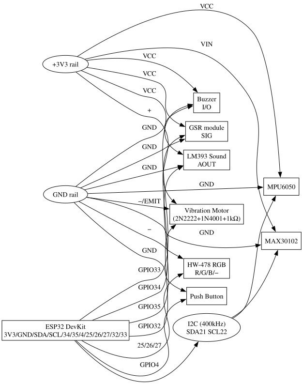

# Circuit Diagram (Schematic & Reference)

This gives a clear wiring schematic for the ESP32 Empathy Band (full system). Use it alongside `connection_diagram.md` for breadboard layout.

## 1. Block diagram


## 2. Power rails
- ESP32 DevKit powered via USB-C (5 V regulated on board to 3.3 V)
- Bus + rail = 3.3 V (from ESP32 3V3)
- Bus − rail = GND
- I2C sensors run at 3.3 V (MPU6050, MAX30102)
- GSR/Sound powered from 3.3 V to keep ADC inputs safe

## 3. I2C bus
- SDA: GPIO21 (pull-ups present on modules; shared bus)
- SCL: GPIO22
- Devices: MPU6050 (0x68), MAX30102 (0x57). Leave AD0 on MPU6050 unconnected.

## 4. Analog inputs
- GSR SIG → GPIO34 (ADC1_CH6), 12-bit, calibrated at boot (30 s)
- LM393 Sound AOUT → GPIO35 (ADC1_CH7), peak-to-peak amplitude used

## 5. Digital inputs
- Push button: between GPIO4 and GND, internal pull-up enabled (`INPUT_PULLUP`). Reads LOW when pressed.

## 6. RGB LED (HW-478, common-cathode)
- R → GPIO25 (LEDC PWM CH0)
- G → GPIO26 (LEDC PWM CH1)
- B → GPIO27 (LEDC PWM CH2)
- `−` (common cathode) → GND
- PWM: 5000 Hz, 8-bit. Check if module has on-board series resistors.

## 7. Buzzer
- I/O → GPIO33
- VCC → 3V3, GND → GND
- `BUZZER_ACTIVE_LOW` in config.h flips polarity if it sounds at boot.

## 8. Vibration motor (discrete driver)
```
3V3 ──┬─────────────────────────┬─ Motor (+)
      │                         │
      ├─[1N4001] (stripe → +)   │
      │                         │
      │                    Motor (−)
      │                         │
GPIO32─[1kΩ]─ Base (2N2222 NPN)
                Collector ──────┘
                Emitter ──────── GND
```
Operation: GPIO32 HIGH → transistor saturates → motor runs. 1N4001 is flyback (freewheel) diode (stripe to +). If motor is a module with IN/VCC/GND, wire IN→GPIO32, VCC→3V3, GND→GND.

## 9. Minimal build schematic
Only: GSR (GPIO34), MAX30102 (I2C), RGB (25/26/27), Buzzer (GPIO33). Sound/IMU/motor/button omitted. Motion=0, sound=false in firmware.
